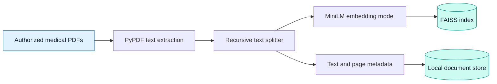
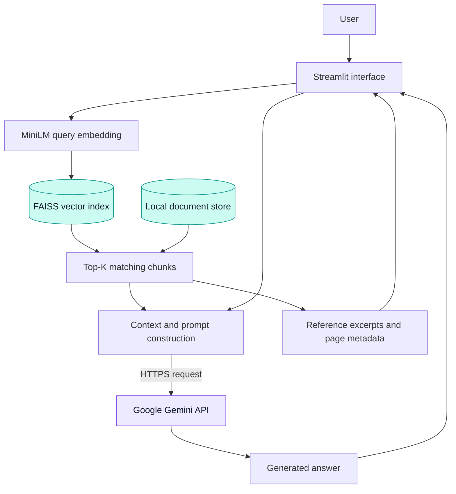
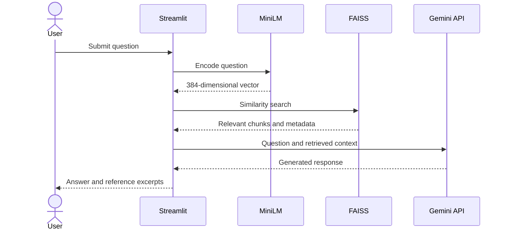

# Medically AI

**A retrieval-augmented medical knowledge assistant built with Python, Gemini, Hugging Face, and FAISS.**


[Overview](#overview) · [Architecture](#system-architecture) · [Getting started](#getting-started) · [Testing](#functional-verification) · [Limitations](#limitations)

## Overview

Medically AI is an educational document-question-answering application that combines local semantic retrieval with cloud-based language generation. It indexes medical reference PDFs into a FAISS vector store, retrieves relevant text for each question, and supplies that context to Google Gemini to generate a readable response with retrieved reference excerpts.

The design separates document ingestion from online inference, allowing the knowledge index to be reused without reprocessing the source PDFs for every question. No custom LLM training or local generative model download is required.

> **Disclaimer:** This is an educational software project, not a clinically validated medical device. Do not use it for diagnosis, treatment, emergency decisions, or private patient data.

## Capabilities

- PDF ingestion, recursive text splitting and overlapping document chunks.
- Local 384-dimensional MiniLM embeddings and FAISS similarity search.
- Context-grounded generation using the Gemini API through an OpenAI-compatible client.
- Interactive Streamlit chat with retrieved source excerpts and PDF page metadata when available.
- Environment-based API authentication and reusable local vector indexes.
- Session-scoped chat display; each question is retrieved independently.

The redesigned interface additionally supports configurable Top-K retrieval, suggested questions, response timing and persistent source display within the active session, if the dashboard update has been applied.

## System architecture

### 1. Offline document indexing



### 2. Online question answering



### 3. Request sequence



### Technical configuration

| Component | Configuration |
| --- | --- |
| Embedding model | `sentence-transformers/all-MiniLM-L6-v2` |
| Embedding dimensions | 384 |
| Chunk size / overlap | 500 / 50 characters |
| Vector search | FAISS CPU, default L2 distance in the original index construction |
| Retrieval | Top-3 by default; configurable 1–5 in redesigned UI |
| Generation model | `gemini-3.5-flash-lite` (tested in the development session; configurable) |
| Inference | Google Gemini API, OpenAI-compatible endpoint |
| Frontend | Streamlit |
| Index persistence | `index.faiss` and `index.pkl` |

Hugging Face supplies the pretrained embedding model. Gemini generates answers. Mistral was used by the upstream implementation but is not part of the current runtime.

## Technology stack

| Layer | Technology | Responsibility |
| --- | --- | --- |
| Application | Python 3.12 | Pipeline and application logic |
| Presentation | Streamlit | Chat and reference display |
| Ingestion | PyPDF, LangChain | PDF loading and text splitting |
| Embeddings | Hugging Face, Sentence Transformers | Semantic vector representations |
| Retrieval | FAISS, LangChain Community | Vector indexing and search |
| Generation | Google Gemini, OpenAI Python SDK | Remote answer generation |

## Repository structure

Recommended flat layout (run commands from the directory containing `medibot.py` if the repository uses a nested application folder):

```text
medically-ai-medical-assistant/
├── medibot.py                  # Streamlit application and RAG orchestration
├── create_memory_for_llm.py    # PDF ingestion and index construction
├── connect_memory_with_llm.py   # Upstream CLI example (legacy Mistral integration)
├── Pipfile
├── Pipfile.lock
├── requirements-locked.txt     # Exported dependencies, if retained
├── .streamlit/
│   └── config.toml             # Optional dashboard theme
├── data/                       # Locally supplied authorized PDFs
├── vectorstore/
│   └── db_faiss/               # Locally generated index and metadata
├── screenshots/                # Optional application screenshots
├── .gitignore
└── README.md
```

The legacy CLI is not required to run the Gemini application. If retained, document it as legacy until it is migrated. Local PDFs, generated indexes, virtual environments and API credentials should not be committed.

## Getting started

### Prerequisites

- Python 3.12, Git and internet access for initial package/model downloads and Gemini inference.
- A Google AI Studio API key with access to the selected model.
- Medical reference PDFs that you have permission to process.

### 1. Clone and create an environment

```cmd
git clone https://github.com/Anmol-Mittal30/medically-ai-medical-assistant.git
cd medically-ai-medical-assistant
py -3.12 -m venv .venv
.venv\Scripts\activate.bat
```

If the application is nested, enter its directory before the environment and installation steps.

### 2. Install dependencies

```cmd
python -m pip install --upgrade pip
python -m pip install pipenv
pipenv requirements > requirements-locked.txt
python -m pip install -r requirements-locked.txt
python -m pip install openai
python -m pip check
```

The upstream lock file pins older LangChain dependencies. Avoid unreviewed major-version upgrades. The OpenAI SDK is used only as a protocol client for Google's endpoint, not to access GPT models.

### 3. Configure Gemini

Create a key at [Google AI Studio](https://aistudio.google.com/apikey). In Windows CMD:

```cmd
set "GEMINI_API_KEY=YOUR_API_KEY"
set "GEMINI_MODEL=gemini-3.5-flash-lite"
```

| Environment variable | Required | Purpose |
| --- | --- | --- |
| `GEMINI_API_KEY` | Yes | Google API authentication |
| `GEMINI_MODEL` | No | Override the application's default generation model |

Model availability and free quotas depend on the API project. Do not commit credentials. CMD variables apply only to the current terminal session.

### 4. Build the knowledge index

Place authorized PDF files in `data/`, then run:

```cmd
python create_memory_for_llm.py
```

The first run downloads MiniLM and generates the FAISS index. Rebuild it whenever the documents or embedding configuration change. Only deserialize indexes you generated or otherwise trust: the LangChain FAISS loader uses pickle metadata.

### 5. Launch the application

```cmd
python -m streamlit run medibot.py
```

Open [http://localhost:8501](http://localhost:8501).

## Example usage

- What is diabetes?
- Explain hypertension in simple terms.
- What is anemia?

Responses depend on the indexed reference material. Inspect the reference excerpts rather than assuming that retrieval or generation guarantees factual accuracy.

## Functional verification

Use the following manual checks after installation or code changes. This is a test plan, not a claim of automated test coverage.

| Test | Expected result |
| --- | --- |
| Index construction | Both FAISS index files are created |
| Supported medical question | Answer and retrieved references are displayed |
| Missing API key | Application explains the configuration problem |
| Out-of-scope question | Assistant declines or identifies insufficient evidence |
| Invalid model or exhausted quota | Error is surfaced without exposing credentials |
| Clear conversation | Active chat history is reset |
| Source display | Retrieved excerpts and available PDF page numbers are visible |

## Design decisions and trade-offs

| Decision | Rationale / trade-off |
| --- | --- |
| RAG rather than fine-tuning | Knowledge can be refreshed by rebuilding the index; no custom model training is required |
| Local MiniLM embeddings | Lightweight CPU-friendly retrieval; embedding quality still limits matching accuracy |
| FAISS local index | Simple persistent semantic search without a managed database; no distributed scaling |
| Cloud Gemini generation | Avoids local LLM memory requirements; introduces network, quota and privacy dependencies |
| Overlapping chunks | Preserves some boundary context at the cost of duplicated text |
| Streamlit | Rapid Python-first interface development; less frontend flexibility than a custom web stack |

## Security and privacy

- Store API keys in environment variables, never in source control.
- Do not load untrusted pickle-based FAISS indexes.
- Do not submit identifiable patient data. Questions and retrieved context are transmitted to Google's API.
- Only index and redistribute documents for which appropriate rights are available.
- Retrieved text is untrusted input; prompt instructions are a mitigation, not a complete defense against prompt injection.

## Limitations

- Semantic similarity does not establish medical relevance or correctness.
- Generated answers can be inaccurate, incomplete or based on outdated documents.
- Reference excerpts show retrieved evidence, not independently verified clinical citations.
- Chat history is displayed but is not used as conversational retrieval memory.
- API availability, latency and quotas depend on the external provider.
- The project has not undergone clinical validation or formal retrieval-quality benchmarking.

## Roadmap

- [ ] Relevance thresholds and retrieval quality evaluation (Recall@K, MRR).
- [ ] Grounded-answer evaluation with a curated question set.
- [ ] Document upload and index lifecycle management.
- [ ] Conversational query reformulation and memory.
- [ ] Automated tests and CI, dependency locking for the Gemini integration.
- [ ] Improved source provenance and current, authorized medical references.

## Troubleshooting

| Issue | Action |
| --- | --- |
| `ModuleNotFoundError` | Activate the virtual environment and install dependencies |
| Missing index | Run the indexing script from the application directory |
| HTTP 401 / 403 | Check API key and model access |
| HTTP 404 | Select a model available to your Gemini API project |
| HTTP 429 | Check rate limits and quota in Google AI Studio |
| Slow first run | Initial model download and index generation can be resource-intensive |

## Project Maintainer & Engineering Contributions

**Anmol Mittal**

[GitHub Profile](https://github.com/Anmol-Mittal30)

This project demonstrates the practical implementation of
Retrieval-Augmented Generation (RAG), semantic information
retrieval, and cloud-based Generative AI integration.

### Key Contributions

- Migration from legacy LLM inference to Google Gemini API.
- Enhancement of the interactive Streamlit application.
- Configurable FAISS-based contextual retrieval.
- Structured source references and response latency tracking.
- Environment-based API authentication and error handling.
- Technical documentation and system architecture design.

### Acknowledgments

Adapted from the existing
[Medically reference implementation](https://github.com/AryamanPurohit/Medically-Streamlit-App).

Third-party components and reference materials remain subject
to their respective licensing and usage terms.

---

*Designed for educational exploration of Generative AI,
semantic search, and document-grounded intelligent systems.*

---

*Built for learning and experimentation in retrieval-augmented generation, semantic search and AI application engineering.*
